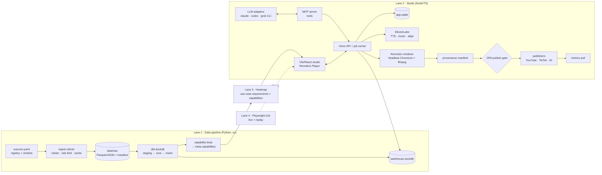

# StatReel — Design Document & Implementation Plan

> Working name: **StatReel** (rename freely). Local-first studio that turns licensed sports data into **30–90 s viz-led videos of stats evolving over time** (matplotlib-style animated charts: bar-chart races, line races, streamgraphs; data time maps to video time; no narration; 9:16 and 16:9), with an LLM co-pilot, a use-case × sport feasibility heatmap, and cross-channel publishing (ADR 007).
>
> **Audience of this document:** a Claude Code session running on the owner's machine that will implement it, plus the owner (Kazi) reviewing progress.
> **Status:** approved design, v1.0 — 2026-09-29.

---

## 0. Instructions for the implementing agent

1. **End-to-end first.** Build the walking skeleton (Milestone M1) through every stage — ingest → transform → query → LLM props → audio → captions → render → policy gate → private upload → metrics — before widening any lane. Design quality and feature breadth come after the full flow passes a live e2e test.
2. **Test-first per milestone.** Write the milestone's e2e test (failing) before implementation. A milestone is done only when its Definition of Done (DoD) checks pass locally with `pnpm e2e:live` (and `pnpm e2e` in replay mode).
3. **Trunk-based, small commits.** One logical change per commit, conventional commit messages. Never commit secrets, raw scraped data, rendered media or `.duckdb` files.
4. **Verify CLI flags before relying on them.** Flags listed for `claude`, `codex`, `grok`, `opa`, `ffmpeg`, `dbt` are from research on 2026-09-29; run `<tool> --help` and adapt. Record deviations in `docs/decisions/`.
5. **Never bypass the ethics layer.** No ingestion code may issue HTTP requests except through `pipeline/statreel_ingest` clients (`EthicalClient`) that enforce the source registry (verdict, robots.txt, rate limits, caching, User-Agent). Sources with verdict `avoid` must be unreachable in code.
6. **Ask the owner** before: creating platform developer apps, spending ElevenLabs credits beyond test budgets (see §6.6), making anything public, or adding a new data source not in the registry.
7. Keep this document current: when a decision changes, update the relevant section and add an ADR in `docs/decisions/NNN-title.md`.

---

## 1. Goals and non-goals

**Goals**
- G1. Ethical, license-aware ingestion of sports data (F1, NBA, NHL, soccer first; extensible) into a local analytical store.
- G2. A living **feasibility heatmap**: which use cases can be produced for which sport, in monetized vs non-commercial mode — computed from data tests, not maintained by hand.
- G3. A local web studio to pick a use case, generate data + narrative with an LLM, compose, preview (scrubbable), render and publish 1–3 min videos.
- G4. LLM engine that wraps local CLIs (Claude Code first, Codex second, Grok third) through one MCP tool surface.
- G5. Project manager with cross-channel publishing (YouTube, TikTok, Instagram) and metrics.
- G6. Provenance for every video: data snapshots, licences, audio generations, fonts, code version → a publish gate enforced as policy-as-code.

**Non-goals (v1)**
- No cloud/SaaS deployment, no multi-user, no auth.
- No concurrency: **one render at a time, one active LLM session at a time** (owner decision).
- No scraping of sources with verdict `avoid`; no broadcast footage, logos, crests or agency photos.
- No mobile app; no desktop shell (Electron possible later, Tauri rejected — see §2).

---

## 2. Decisions (ADR summary)

| # | Decision | Rationale | Rejected / revisit |
|---|---|---|---|
| D1 | **TypeScript monorepo, local web app: Vite + React SPA, Hono (Node 22) backend** | Long-running jobs, child-process lifecycle, SSE/WebSocket streaming, no SSR/RSC overhead; Hono RPC for end-to-end types | Next.js (request-scoped handlers, HMR orphaning child processes, custom server needed for WS). Tauri (system WebView ≠ Chromium export → preview/export drift; adds Rust) |
| D2 | **Remotion 4.x** as composition/render engine | React-native Player for in-app scrubbing, Zod-typed nested props, `renderMedia()` API, mature; free for individuals/≤3-employee companies | **HyperFrames** (HeyGen, Apache-2.0, pre-1.0): advantages = Apache licence, built-in audio mixing & captions, agent skills, plain-HTML authoring. **Revisit when HyperFrames ≥ 1.0.** Mitigation: chart logic is pure `(data, t) → SVG` in `packages/viz`, framework-agnostic |
| D3 | **DuckDB** for analytics (raw Parquet → dbt models → marts) | Reads CSV/JSON/Parquet natively, fast window functions, spatial ext, LLM-friendly SQL, Node + Python + WASM clients | PGlite (single-connection WASM Postgres; slower analytics) |
| D4 | **SQLite** for app state (projects, jobs, renders, publications, metrics) | Embedded, durable single-slot job queue | — |
| D5 | **Python only for data jobs** (uv-managed): Scrapy/httpx ingestion, dbt-duckdb, models (xG, UMAP, adjustments). Invoked as CLI jobs by the Node backend | Best ecosystem for scraping/ML; no long-running Python service | Python API server |
| D6 | **Licence lineage as policy-as-code** (OPA/Rego, evaluated via `opa` CLI or opa-wasm) | Every video carries lineage; publish gate blocks monetized publishing with non-commercial inputs | Hand checks |
| D7 | **App exposes an MCP server**; LLM CLIs are interchangeable clients | One tool surface for Claude Code / Codex / Grok; LLM emits validated props + read-only SQL, never runtime code | Per-CLI bespoke integrations |
| D8 | **ElevenLabs** for TTS, music (Eleven Music), SFX, alignment | Owner has credits; commercial rights on paid plans | — |
| D9 | **Burned-in captions everywhere + SRT/VTT sidecar on YouTube** | TikTok/Instagram APIs have no caption-file field | — |
| D10 | **OFL fonts only, self-hosted, pinned** | Commercial-safe, server-render-safe, deterministic | Adobe Fonts / desktop EULAs (no server rendering) |
| D11 | **f1db via the GitHub Releases API** ([ADR 001](docs/decisions/001-f1db-via-github-releases-api.md)) | github.com/robots.txt disallows `/*/download`; the API + registered redirect host is allowed | Release download URL |
| D16 | **Format: 30–90 s viz-led time-evolution videos, no narration** ([ADR 007](docs/decisions/007-format-time-evolution-videos.md)) | Owner: the data visualization tells the story over time; shorts are cut-outs of long runs | Narrated headline shorts (hook → reveal → payoff) |
| D21 | **Page loading discipline: lazy routes, staggered arrival, transitions, revalidating reads** ([ADR 012](docs/decisions/012-page-loading-discipline.md)) | Every screen is a chunk with loader-prefetched data; sections mount top to bottom behind reserved placeholders; `/api` is gzip + ETag; hashed assets immutable | Heatmap grid left atomic (ARIA grid + focus registry) |
| D20 | **Topic activity heatmap: controlled topic list + `videos` ledger** ([ADR 011](docs/decisions/011-topic-activity-heatmap.md)) | Owner: a topic is a broad domain (a type of sport, a geo-economic discipline) from a fixed list; one row per topic, column n = n-th finished video, filled by recency | Free-text topic labels; scanning the file system for videos |
| D17 | **Board libraries + text-only case loop + generated images as art supplement** ([ADR 008](docs/decisions/008-board-libraries-case-loop-images.md)) | Owner: cases were locked in our own data and styles in the same x/y charts; judge stories apart from looks, expand domains via approved sources | Judging style and case only together on designs |
| D15 | **Two themes (A/1 dark, A/3 light), Calendar, Board** ([ADR 006](docs/decisions/006-two-themes-studio-modules.md)) | Owner: keep both winners until one dominates; studio composes, Calendar publishes; Board gates visual direction | Single baseline |
| D14 | **"On Air" brand + UI baseline, real data only** ([ADR 005](docs/decisions/005-on-air-brand-baseline.md)) | Owner verdict on the `--landing` contest | Patchbay (temporary) |
| D13 | **Knowledge-review changes adopted** ([ADR 003](docs/decisions/003-media-generation-knowledge-review.md)) | Fail-closed gate, fact binding, spoken/display tokens, hook/close craft, mix and peak targets | — |
| D12 | **Capability tests declared in YAML, evaluated in Python** ([ADR 002](docs/decisions/002-capability-tests-in-python.md)) | One row per capability with coverage, rows and a reason; dbt tests keep schema integrity | dbt tests as capability carriers |

---

## 3. Architecture



**Runtime:** `pnpm dev` starts Vite (5173) and Hono (8787, serves `/api`, `/mcp`, SSE `/events`). Production-like: `pnpm start` → Hono serves the built SPA. Everything binds to `127.0.0.1` only.

**Single-slot job runner:** jobs (`ingest`, `transform`, `audio`, `render`, `publish`, `metrics`) persisted in SQLite; one render and one LLM session at a time (mutex per kind); cancellable (AbortSignal → child process kill); resumable after restart; progress streamed over SSE.

---

## 4. Repository layout

```
statreel/
  DESIGN.md                 # this file
  CLAUDE.md                 # short agent rules (derive from §0)
  package.json  pnpm-workspace.yaml  turbo.json (optional)  justfile
  apps/
    studio/                 # Vite + React SPA (TanStack Router + Query, Remotion Player)
    server/                 # Hono API, job runner, MCP server, publishers, policy gate
  packages/
    viz/                    # pure chart primitives: (data, t, theme) → SVG elements; no Remotion imports
    compositions/           # Remotion compositions per use case (thin wrappers over viz)
    schemas/                # Zod schemas: use cases, props, manifests, source registry
    captions/               # word timing → cues → burn-in component + SRT/VTT writers
    audio/                  # ElevenLabs client, mixing plan, loudness checks
    llm/                    # CLI adapters (claude, codex, grok), session mgmt, replay fixtures
    publish/                # youtube, tiktok, instagram adapters + metrics
    design-tokens/          # colors, type scale, safe zones, motion constants
  data/                     # gitignored except registry and fixtures
    registry/sources.yaml   # committed
    registry/usecases/*.yaml# committed
    raw/ warehouse.duckdb renders/ audio/ cache/
  pipeline/                 # Python (uv project)
    pyproject.toml
    statreel_ingest/        # clients, robots, rate limiter, cache, snapshotting
    dbt/                    # dbt-duckdb project (models, tests, macros, meta.licence)
    models/                 # xG, UMAP similarity, era adjustment jobs
    tests/
  policy/
    publish.rego  publish_test.rego
  fonts/                    # self-hosted OFL fonts + OFL.txt each + fonts.manifest.json
  e2e/                      # Playwright tests, fixtures, golden frames
  docs/decisions/           # ADRs
```

**Toolchain:** Node 22 LTS (Fox runs Node 24 arm64 for the app and a Node 22 x64 render worker, ADR 004), pnpm 9+, TypeScript 5.x strict, Vitest, Playwright, Biome (lint+format), Python 3.12 via `uv`, dbt-duckdb, ffmpeg/ffprobe ≥ 6, OPA ≥ 1.0 (Rego v1 syntax), DuckDB (Node: `@duckdb/node-api`; Python: `duckdb`), SQLite via `better-sqlite3` + Drizzle ORM, MCP via `@modelcontextprotocol/sdk`, secrets via OS keychain (`@napi-rs/keyring`).

---

## 5. Lane 1 — Data resources pipeline

### 5.1 Source registry (`data/registry/sources.yaml`)

Single source of truth for what may be fetched and how. Ingestion refuses any host not in the registry.

```yaml
- id: f1db
  sport: F1
  url: https://github.com/f1db/f1db
  access: api                    # bulk_download | api | html_scrape | manual  (ADR 001)
  hosts: [api.github.com, release-assets.githubusercontent.com]   # the only hosts the client may reach
  verdict: legal                 # legal | non_commercial | paid | avoid
  license: CC-BY-4.0
  attribution: "Data: F1DB (CC BY 4.0)"
  kinds: [hist, bio, live]
  coverage: {from: 1950, to: current}
  rate_limit: {requests: 60, per_s: 3600}   # published limit; client runs at <= 50 %
  terms_url: https://github.com/f1db/f1db/blob/main/LICENSE
  terms_checked_at: 2026-09-29
  notes: "Released after every race; no telemetry."
```

**Data kinds** (shared vocabulary with use cases): `hist` (results/career stats), `bio` (biographical), `events` (event/shot-level with x/y), `track` (tracking/telemetry), `live` (current season, fast updates), `money` (transfers/finance).

**Seed registry (research 2026-09-29)** — see Appendix A for full table. Summary:

| Sport | Legal (monetized OK) | Non-commercial / permission needed | Avoid (no automated access) |
|---|---|---|---|
| F1 | f1db (CC BY 4.0), Wikidata (CC0) | Jolpica-F1 (CC BY-NC-SA; 4 req/s, 500/h), OpenF1 (CC BY-NC-SA; free 3 req/s, 30/min), FastF1 (F1 timing data ©) | formula1.com |
| NBA | balldontlie (display allowed; free 5/min), Wikidata | nba_api/stats.nba.com, hoopR (ESPN) · Sportradar = paid | Basketball-Reference scraping (20/min jail), SportsDataIO trial (scrambled) |
| NHL | Wikidata | NHL API (api-web.nhle.com), MoneyPuck (non-commercial + credit), hockeyR/fastRhockey, Natural Stat Trick (unverified) | Hockey-Reference scraping, Evolving-Hockey |
| Soccer | Wyscout public 2017/18 (CC BY 4.0), SkillCorner (MIT), Metrica sample (credit), openfootball (CC0), Wikidata/Wikipedia, football-data.org (attribution) | StatsBomb Open Data (no commercial use of data or derived analysis), Understat, football-data.co.uk · API-Football = paid/confirm media use | FBref scraping (10/min; advanced stats gone since Jan 2026), Transfermarkt, FotMob, SofaScore |

### 5.2 Ethical ingestion rules (enforced in code)

- Only registry sources; `verdict: avoid` → hard error. `access: manual` → CLI helper to import a hand-exported CSV with provenance note.
- Prefer bulk downloads and official APIs over HTML scraping.
- robots.txt fetched and cached (24 h) and obeyed (`protego`); Scrapy with `ROBOTSTXT_OBEY=True`, `AUTOTHROTTLE_ENABLED=True`, `HTTPCACHE_ENABLED=True`.
- Per-host token bucket at **≤ 50 % of the published limit** (default 1 req / 3 s when none published).
- User-Agent: `StatReel/<version> (+mailto:<owner-contact>)` — owner provides contact in config.
- Conditional requests (ETag / If-Modified-Since); never re-fetch unchanged resources.
- Every fetch logged to `data/raw/<source>/<snapshot>/fetch_log.jsonl` (url, status, bytes, duration).
- **Terms monitoring:** monthly job fetches each `terms_url` once, stores SHA-256; hash change → flag source `needs_review` in heatmap and block new ingests until owner re-approves.
- EU context: avoid substantial/repeated extraction from protected databases (Directive 96/9/EC Art. 7); respect TDM opt-outs (DSM Directive Art. 4) — a ToS scraping ban counts as opt-out.

### 5.3 Raw layer

`data/raw/<source_id>/<snapshot_utc>/` containing files (converted to Parquet where tabular) plus `manifest.json`:

```json
{"source_id":"f1db","snapshot":"2026-09-29T18:00:00Z","license":"CC-BY-4.0","verdict":"legal",
 "files":[{"path":"races.parquet","sha256":"…","rows":1125}],"fetch_log":"fetch_log.jsonl","tool_version":"0.1.0"}
```

Raw snapshots are immutable. A `current` pointer per source selects the snapshot used by dbt.

### 5.4 Transform (dbt-duckdb)

- Schemas: `staging_<source>` → `core` (conformed: `players`, `teams`, `competitions`, `seasons`, `matches`, `player_season_stats`, `events`, `tracks`) → `marts` (one per use case family, e.g. `mart_era_adjusted`, `mart_shot_maps`).
- Every source model declares `meta: {license_class: legal|non_commercial|paid, source_id: …}`.
- `pipeline/statreel_ingest/lineage.py` reads `target/manifest.json` and computes for each model the **most restrictive** upstream licence class and the set of upstream sources → writes `meta.model_lineage(model, license_class, sources[])` into DuckDB.
- **Capability tests** (declared in `pipeline/capabilities.yaml`, evaluated in Python after `dbt build` — ADR 002; dbt tests keep schema integrity) per sport × kind: row counts, coverage years, null ratios, coordinate ranges. Results → `meta.capabilities(sport, kind, source_id, license_class, coverage_from, coverage_to, rows, status, detail, evaluated_at)`.
- Curated **read-only views** for the LLM in schema `llm` with column comments (dbt `persist_docs` → DuckDB comments) — the only schema the MCP `query` tool can read. Every row carries a stable `fact_key` (for binding on-screen figures to facts) and the `attribution` string; adjusted metrics carry a plain-language `method`.

### 5.5 Models (Python batch jobs writing DuckDB tables)

- Era adjustment (league scoring rate, penalties excluded, per 90; F1 points normalized to current points system).
- xG (logistic/GBM on open event data — Wyscout CC BY for monetized use; StatsBomb only for non-commercial).
- Player similarity (per-90 feature vectors → UMAP fit once, transform per season; cosine similarity).
- xT grid (Karun Singh method) on open event data.

---

## 6. Lane 2 — Studio app

### 6.1 Screens (single-page app)

Two winning themes on one module structure (ADR 006): **On Air** (`onair`, dark, contest A/1) and
**Photo Finish** (`photofinish`, light, contest A/3). The owner switches between them in the nav. Every
screen shows real data or a labelled empty state (ADR 005).

1. **Front**: the brand's front door, with a fast lane (heatmap, studio, resume) and the latest real
   project on the monitor or finish strip.
2. **Heatmap**, in two layers:
   - layer 1 is the dedicated grid (use case × sport, monetized / non-commercial mode, trend);
   - layer 2 is a cell's detail (kinds, sources, licence text, reason, make-next picks, Create
     project) (§7).
3. **Rundown** (projects): idea → data ready → scripted → rendered → gated → published, with a metrics
   sparkline per project.
4. **Studio** (per project) is for **composing only**:
   - the player is the centred main content;
   - the tracks timeline spans the full width (scenes, voice, music, captions);
   - the script opens in a modal;
   - the side columns hold parametrisation: use case, dataset and props form on the left, the LLM
     co-pilot with its tool-call log on the right.

   A tab holds **Render & Gate**: render progress (SSE), ffprobe report, policy verdict with reasons,
   provenance manifest viewer.
5. **Calendar**: channel management (YouTube; TikTok and Instagram from M5) and timing on top of
   composed videos. Schedule a gated render on a channel at a time; a scheduler publishes due items
   (private or draft only).
6. **Board**: three tabs (ADR 006, ADR 008).
   - **Designs**: cut-outs of 30–90 s design runs behind the owner's gate (accept, reject style,
     reject case, reject both).
   - **Styles**: a gallery of every style with its verdict. The owner locks a signature, retires a
     style, adds a note or picks a hero.
   - **Use cases**: registry formats, cases accepted through designs, and the inbox of text-only
     **case ideas**. Each idea covers a decade or more, with at least 4 beats, a tension and
     web-verified sources. The owner accepts it or rejects it as too short, no insight, no data or
     duplicate.

   All three are fed by the `board` skill (`loop`, `mass`, `cases`), whose Obsidian ledger loops on
   the feedback. Design seats may add generated imagery (texture, scene, never data).
7. **Metrics**: cross-channel table and charts (views, average view duration, retention where
   available, likes, comments, shares), per use case and per sport.
8. **Sources**: registry view, verdicts, tested capabilities, terms-hash status.

### 6.2 Composition model (ADR 007: time-evolution videos)

- **Use case registry** `data/registry/usecases/<id>.yaml`. Every time-evolution format declares:
  - `data_time {unit, from, to}`: what the clock runs through (season, race, matchday, career-start, date)
  - `chart_form`: bar-chart race, line race, streamgraph, drifting distribution, and so on
  - `arc`: what the viz reveals as time passes
  - `duration_s` (30–90), required data `kinds`, and optional `sports` for sport-specific formats

  `family: headline` marks the legacy M1 walking skeleton (`era-adjusted-rankings`), which the M1
  rework replaces.
- `packages/viz`: pure functions of `(data, t, theme, format)` returning SVG primitives. The
  time-evolution primitives are bar race (rank interpolation, identity-stable colours), line race,
  streamgraph, rolling-window aggregations and a data clock. There is no time source other than `t`,
  and randomness is seeded.
- `packages/compositions`: a Remotion `<Composition>` per use case × format. Video time maps to data
  time through a **pacing curve**: seconds per unit, eased, slower at the story's turns, and the clock
  never stops for long. **Annotations** are data in props (`annotations[] {at_data_time, text, facts[]}`),
  each held ≥ 2 s. The picture is **viz-led**: title, running data clock, chart, sparse annotations.
  No narration.
- The co-pilot chooses the story over time: the data range, the entities, the pacing curve and the
  annotation beats, each bound to facts. It never writes code.
- **Board** (§6.1): designs are full 30–90 s runs, judged by one mid-run cut-out plus harness-measured
  longevity (the `board` skill).

### 6.3 Render pipeline

- `bundle()` once per code version (cached by git SHA); `selectComposition` + `renderMedia({codec: "h264", crf: 18, pixelFormat: "yuv420p", audioCodec: "aac"})`.
- Formats: 1080×1920 @30 fps (vertical), 1920×1080 @30 fps (landscape). Duration per use-case band (e.g. era-adjusted vertical 45–75 s); platform ceilings (Shorts ≤ 3 min) are limits, not targets.
- Chromium: fonts loaded from `fonts/` only; network requests to external hosts **blocked** during render; render fails if `document.fonts` reports any fallback.
- Post-render checks (ffprobe + ffmpeg): resolution, fps, duration, codecs, integrated loudness **−14 LUFS ±1**, true peak ≤ **−2 dBTP** (platforms re-encode to lossy), loudness range recorded (`ebur128`), black-frame detect.
- Output `data/renders/<project>/<run>/`: `video.mp4`, `captions.srt`, `captions.vtt`, `thumb.png` (frame chosen by props), `manifest.json` (§6.8).
- Single render at a time; progress over SSE.

### 6.4 Audio (ElevenLabs)

> ADR 007: videos are viz-led with **no narration**. Audio is a music bed (Eleven Music) plus optional SFX. The TTS, alignment and caption timing below apply only to a future format with speech; the live M1 skeleton still uses them until its rework.

- **Plan requirement:** all assets destined for monetized channels must be generated on a **paid plan (Starter+)**; free-plan output is non-commercial forever. Creator+ only if tracks are ever distributed to streaming services. Record plan tier per asset.
- **Voiceover:** generated **per scene** (a note re-renders one scene; joins are checked) with `POST /v1/text-to-speech/{voice_id}/with-timestamps` → audio + **character-level** alignment; group characters into words in `packages/captions`. Script tokens carry a `spoken` and a `display` form ("twenty-three" / "23") plus a pronunciation ledger; alignment runs on the spoken form, burn-in shows the display form. Re-timing after edits: `POST /v1/forced-alignment` (audio + transcript → word/char timings).
- **Music:** generated **after** TTS is measured, at the exact needed length (off-length takes are rejected, never stretched), spotted cue by cue with deliberate silences; `POST /v1/music` (`music_v2`/`music_v2_5`, `force_instrumental: true`, `music_length_ms` 3000–600000, composition plan per scene). Keep stems via `/v1/music/stem-separation` so a bed can be swapped if a claim appears. Outputs may not be unique across users → **never register in Content ID**.
- **SFX:** sound-effects API (≤ 30 s per generation) for transitions/whooshes; no beta features in commercial output.
- **Mix plan** (Remotion `<Audio>` tracks): voice as anchor; music ducked **6–12 dB** under voice (tunable); audio leads picture by 0.5–2 s at scene changes; SFX sparse. Master target −14 LUFS integrated, ≤ −2 dBTP.
- **Rules:** no voices imitating real athletes/commentators; no "in the style of <artist>" prompts; opt out of ElevenLabs training if scripts are proprietary; cache every generation by request hash to save credits.
- **Test budget:** replay fixtures by default; live e2e may generate ≤ 75 s TTS and ≤ 75 s music per run, and every generation is cached by request hash, so a rerun with an unchanged script costs nothing (owner decision 2026-09-29).

### 6.5 Captions & typography baseline (research 2026-09-29)

**Captions**
- Burned into every export (TikTok/Instagram APIs have no caption-file field); YouTube additionally gets SRT/VTT via `captions.insert` (400 quota units).
- One timed-word JSON is the source for both burn-in and sidecar.
- Cue rules: ≤ 2 lines; ≤ 42 chars/line landscape; vertical is limited by the safe-zone width, not the Netflix 32: at 76 px Inter Bold (≈0.56 em/char) the 885 px critical box fits **≈ 19 chars/line** (`maxCharsPerLine(format)` in `packages/captions`; measured 2026-09-29); reading speed target 15–17 CPS, hard max 20 CPS; cue duration 0.8–7 s; min gap 2 frames (Netflix timed-text guide).
- Vertical style: 70–85 px text at 1920 h, weight 700, white on ~70 % black box or heavy stroke, contrast ≥ 4.5:1 (WCAG 2.2 SC 1.4.3); active-word highlight (accent colour) on shorts.
- **Safe zone (union of TikTok, Reels, Shorts), 1080×1920:** top 270 px, bottom 670 px, left 65 px, right 130 px → critical-content box ≈ 885×980 px; captions sit just above y ≈ 1250. Debug overlay in Studio and in test renders. (Platforms publish templates, not text specs — values are a conservative union; re-check yearly.)
- Accessibility law: the European Accessibility Act binds platforms, not an individual creator; treat WCAG 2.2 SC 1.2.2 (captions, prerecorded) as the standard anyway.
- Rationale data: 49 % always/often use captions, 59–64 % among 18–34 (XR/M8 Labs, May 2026). (The often-quoted "69 % sound off" figure comes from muted-autoplay feeds, not the shorts platforms, which play sound by default. It is not used as a rationale; ADR 003.)

**Fonts**
- OFL 1.1 only (commercial use in video allowed, no attribution required). No Adobe Fonts (no server installation) and no desktop-EULA commercial fonts on the render path.
- `fonts/` committed with each `OFL.txt` and `fonts.manifest.json` (`family, version, source_url, license, sha256`). Self-hosted `@font-face`; Google Fonts CDN blocked during render (determinism; GDPR precedent LG München I, 3 O 17493/20, 2022, relevant for any web player).
- **Numbers must use tabular figures** (`font-variant-numeric: tabular-nums`); CI check rejects faces without `tnum` on numeric layers.
- Default set: **Barlow Condensed** (display + numerals, has `tnum`), **Inter** (UI/body, enable `tnum`), **JetBrains Mono** (data labels; tabular by default), **IBM Plex Sans** (alternative, tabular default). **Big Shoulders Display / Oswald: headlines only** (no `tnum` → counters jitter).

### 6.6 LLM engine

**Principle:** the LLM works through the app's MCP tools; it produces validated JSON props and read-only SQL, plus narration text. It does **not** write composition code at runtime (new compositions are developed as normal code changes).

**MCP server** (`/mcp`, streamable HTTP, localhost) tools:

| Tool | Purpose |
|---|---|
| `list_use_cases` | registry + current heatmap status |
| `describe_views(sport)` | `llm.*` views with column comments and sample rows |
| `query(sql)` | read-only DuckDB on `llm` schema; row cap 5 000; 10 s timeout; returns rows + lineage licence class |
| `get_props_schema(use_case)` | JSON Schema from Zod |
| `set_props(project, props)` | validate + store; returns validation errors verbatim |
| `write_script(project, scenes[])` | narration per scene; CPS/length checks returned |
| `generate_audio(project, kind)` | TTS / music (respects budget) |
| `render_keyframes(project, frames[])` | PNG stills for critique (multimodal feedback loop) |
| `get_render_report(project)` | ffprobe, loudness, caption and safe-zone checks |
| `policy_check(project, target)` | publish gate verdict with reasons |

**Adapters** (`packages/llm`) — spawn CLI as child process, stream JSON events to UI over SSE, persist session id for resume:

| Engine | Invocation (verify with `--help`) | MCP config | Priority |
|---|---|---|---|
| Claude Code | `claude -p "<prompt>" --output-format stream-json --verbose --mcp-config .statreel/mcp.json --allowedTools "mcp__statreel__*"`; resume with `--resume <session_id>` | project `.mcp.json` / `--mcp-config` | P0 |
| Codex CLI | `codex exec --json "<prompt>"` (resume support: verify) | `[mcp_servers.statreel]` in `~/.codex/config.toml` | P1 |
| Grok CLI | **unverified** which CLI is current and whether it supports MCP/headless JSON — investigate at M3 start; fallback: adapter via xAI API with tool-calling mapped to the same tool handlers | — | P2 |

- One active session at a time; engine switchable between sessions.
- **Replay mode:** adapters record `(prompt hash → event stream)` fixtures in `e2e/fixtures/llm/`; `LLM_MODE=replay|live`.
- Visual critique loop: after `render_keyframes`, the agent fills a typed yes/no schema (veto fields first: hierarchy, legibility at phone size, data-ink); safe zone and contrast are **measured in code**, not judged. Revisions are patch operations on props, with the gate re-run after each (max 2 iterations by default).
- Word budget is a range; timing is judged on the rendered audio, and figures and hedges are never cut to fit.
- A refusal (LLM or audio provider) is a labelled job state, never an empty success.
- System prompt pack per use case in `packages/llm/prompts/` (hook formulas, narration length targets: ~150–165 wpm; 60 s ≈ 150–165 words).

### 6.7 Publishing & metrics

| Platform | API | Constraints (verified 2026-09-29) | v1 behaviour |
|---|---|---|---|
| YouTube | Data API v3 `videos.insert` (resumable), `captions.insert`, `thumbnails.set`; YouTube Analytics API for metrics | `videos.insert` costs 1 unit in the separate *Video Uploads* bucket, 100 calls/day; **unverified API projects (created after 2020-07-28) → uploads forced private until audit**; captions.insert 400 units | Upload **private**, owner flips to public; tick "altered or synthetic" disclosure when AI music is used |
| TikTok | Content Posting API: **Upload** (to creator inbox/drafts) or **Direct Post** | **Unaudited clients: all content private**; no caption-file field | Use Upload (draft) by default; Direct Post after audit; set AIGC flag when applicable |
| Instagram | Graph API content publishing (Reels) | Professional account required; **local-file resumable upload only with Facebook Login for Business**, else a public `video_url`; 100 API-published posts / 24 h | Implement with Facebook Login for Business (no public URL needed) |

- OAuth: tokens in OS keychain. Google supports loopback redirect (`http://127.0.0.1:<port>`). **Open question:** TikTok/Meta redirect URI rules for local apps (may require HTTPS / registered domain) — investigate at M5; fallback = local HTTPS with mkcert.
- **Start platform audits in week 1** (owner task) — they gate public publishing.
- Metrics job (daily, and on demand): `metrics_daily(publication_id, date, views, watch_time_s, avg_view_duration_s, likes, comments, shares, subs_delta)`; normalized across platforms; unavailable fields null.

### 6.8 Provenance manifest & publish gate

`manifest.json` per render (in-toto-style subject/predicate; optional signing later):

```json
{
  "subject": {"file": "video.mp4", "sha256": "…"},
  "build": {"git_sha": "…", "composition": "EraAdjustedSlope@1.2.0", "props_sha256": "…", "renderer": "remotion@4.x"},
  "data": {"models": ["mart_era_adjusted"], "license_class": "legal",
           "sources": [{"id": "f1db", "snapshot": "2026-09-29T18:00:00Z", "license": "CC-BY-4.0", "license_class": "legal", "verdict": "legal", "attribution": "Data: F1DB (CC BY 4.0)"}]},
  "audio": [{"kind": "tts", "provider": "elevenlabs", "request_id": "…", "model_id": "…", "voice_id": "…", "plan_tier": "creator", "generated_at": "…", "sha256": "…", "c2pa": true},
            {"kind": "music", "provider": "elevenlabs", "model_id": "music_v2", "prompt_sha256": "…", "plan_tier": "creator", "sha256": "…"}],
  "fonts": [{"family": "Barlow Condensed", "license": "OFL-1.1", "sha256": "…"}],
  "captions": {"burned_in": true, "sidecar": ["captions.srt"], "max_cps": 18.4},
  "checks": {"loudness_lufs": -14.2, "true_peak_dbtp": -1.3, "safe_zone_violations": 0},
  "llm": {"engine": "claude-code", "session_id": "…"}
}
```

`policy/publish.rego` (Rego v1) — input = manifest + target:

```rego
package statreel.publish

default allow := false
allow if count(deny) == 0

deny contains msg if {
  input.target.monetized
  some s in input.manifest.data.sources
  s.license_class != "legal"
  msg := sprintf("source %s is %s: not allowed on a monetized channel", [s.id, s.license_class])
}
deny contains msg if {
  some s in input.manifest.data.sources
  s.verdict == "avoid"
  msg := sprintf("source %s has verdict avoid", [s.id])
}
deny contains msg if {
  input.target.monetized
  some a in input.manifest.audio
  a.plan_tier == "free"
  msg := sprintf("%s audio generated on free plan (non-commercial)", [a.kind])
}
deny contains msg if {
  some f in input.manifest.fonts
  f.license != "OFL-1.1"
  msg := sprintf("font %s is not OFL", [f.family])
}
# Fail closed (ADR 003): a required field that is missing is a deny, not a pass.
deny contains sprintf("missing evidence: %s", [f]) if {
  some f in {"captions.max_cps", "checks.safe_zone_violations", "checks.loudness_lufs", "checks.true_peak_dbtp"}
  not has_path(input.manifest, split(f, "."))
}
deny contains "no fonts recorded" if count(object.get(input.manifest, "fonts", [])) == 0
deny contains sprintf("%s audio has no plan_tier", [a.kind]) if {
  some a in input.manifest.audio
  not a.plan_tier
}
deny contains "loudness outside -14 LUFS +/-1" if abs(input.manifest.checks.loudness_lufs + 14) > 1
deny contains "true peak above -2 dBTP" if input.manifest.checks.true_peak_dbtp > -2
deny contains "captions not burned in" if not input.manifest.captions.burned_in
deny contains "caption reading speed above 20 CPS" if input.manifest.captions.max_cps > 20
deny contains "safe-zone violations" if input.manifest.checks.safe_zone_violations > 0
deny contains "AI music used but disclosure flag not set" if {
  some a in input.manifest.audio
  a.kind == "music"
  not input.target.ai_disclosure
}
```

The gate's result lists every check it ran (`checks_run[]`) as well as its denials. Attribution strings from all sources are auto-appended to the description; gate warns (not denies) if the description was edited to remove them.

---

## 7. Lane 3 — Feasibility heatmap (long-term monitor)

- **Inputs:** use-case `requires` (kinds, min seasons, formats) × `meta.capabilities` × implementation status (composition exists + its e2e passes) × registry flags (`needs_review`).
- **Cell status** per (use case, sport, mode):
  - `Go` — every required kind has ≥ 1 passing capability whose licence class is allowed in the mode (monetized: `legal`; non-commercial: `legal|non_commercial`) **and** composition implemented.
  - `Data ready` — data Go, composition not implemented yet.
  - `Ask` — best available source is `non_commercial` (monetized mode) or `paid`.
  - `Blocked` — no source, failing tests, or `needs_review`.
- Recomputed after every ingest/transform run and every e2e run; snapshot stored in `app.sqlite: heatmap_snapshots(run_id, at, cells_json)` for trend view ("cells turned Go this month").
- Extensible: new sport = registry entries + staging models + capability tests; new use case = one YAML + composition. No heatmap code changes.
- UI: grid (use cases × sports), mode toggle, per-cell drawer listing sources, licence classes, failing tests, and "create project" action; trend sparkline per row.

---

## 8. Lane 4 — Testing strategy (e2e first, live)

| Level | Tooling | Scope |
|---|---|---|
| Unit | Vitest, pytest | viz scales/primitives, caption segmentation (CPS, line breaking), rate limiter, robots handling, lineage calc, adapters' stream parsers |
| Policy | `opa test policy/` | every deny rule has positive + negative cases |
| Data | dbt tests | schema, coverage, capability tests |
| Visual | Remotion `renderStill` at fixed frames + `pixelmatch` vs goldens (threshold 0.1 %) | each composition × format |
| E2E replay | Playwright, `LLM_MODE=replay`, `AUDIO_MODE=replay`, `PUBLISH_MODE=dry` | full flow in < 5 min, deterministic |
| **E2E live** | Playwright, all live, `pnpm e2e:live` | real ingest (small legal source), real Claude CLI, real ElevenLabs (budgeted), real render, real **private** YouTube upload to a test channel, verify via API, then delete (`videos.delete`, 50 units) |

**E2E assertions for the walking skeleton**
- UI: heatmap shows F1 × era-adjusted = `Go` after ingest; create project; LLM panel shows tool calls; props validate; Player scrubs.
- Artifacts: `video.mp4` 1080×1920, 30 fps, h264/aac, duration 45–75 s; loudness −14 ±1 LUFS, TP ≤ −2 dBTP; SRT valid, max CPS ≤ 20; zero safe-zone violations (DOM bounding boxes measured in a still render); no font fallback; manifest schema-valid; policy `allow == true` for monetized target.
- Negative e2e: project using a `non_commercial` source → gate denies with the expected message.
- Publish: API returns video id; `privacyStatus == "private"`; captions track present; cleanup succeeds.

**Commands (justfile / pnpm):** `just setup`, `pnpm dev`, `pnpm test`, `pnpm e2e`, `pnpm e2e:live`, `just ingest <source>`, `just transform`, `just heatmap`, `opa test policy`.

---

## 9. Data model (app.sqlite, Drizzle)

- `projects(id, title, use_case_id, sport, format, mode[monetized|nc], status, created_at)`
- `project_props(project_id, version, props_json, schema_version, created_by[user|llm])`
- `scripts(project_id, version, scenes_json, words, est_duration_s)`
- `assets(id, project_id, kind[tts|music|sfx|thumb], provider, request_id, model_id, voice_id, plan_tier, prompt_sha256, path, sha256, generated_at)`
- `jobs(id, kind, project_id, status, progress, params_json, error, started_at, finished_at)`
- `renders(id, project_id, job_id, format, path, manifest_path, checks_json, policy_json)`
- `llm_sessions(id, engine, external_session_id, project_id, started_at, ended_at, fixture_path)`
- `llm_events(session_id, seq, type, payload_json, at)`
- `publications(id, render_id, platform, external_id, visibility, url, published_at, status)`
- `metrics_daily(publication_id, date, views, watch_time_s, avg_view_duration_s, likes, comments, shares, subs_delta)`
- `heatmap_snapshots(run_id, at, cells_json)`
- `topics(key, label, family, sort, active)`: the controlled topic list, seeded from `TOPIC_SEED`; `case_ideas.topic` and `projects.topic` reference it (ADR 011)
- `videos(id, topic_key, topic_label, topic_source, case_id, project_id, render_id, generation_job_id, title, format, duration_s, path, created_at)`: one row per finished MP4, the ledger behind `GET /api/heatmap/topics` (ADR 011)
- `settings(key, value_json)` (non-secret)

DuckDB `warehouse.duckdb`: schemas `staging_*`, `core`, `marts`, `llm` (views), `meta` (`capabilities`, `model_lineage`, `ingest_runs`, `source_snapshots`).

---

## 10. Milestones

Each milestone ends with its DoD passing. Estimates assume one agent working with owner review.

**Status (2026-09-30):**
- **M0 done.** `pnpm test` (244), `opa test policy` (72), pytest (56), and the studio serves.
- **M1 done except one owner-gated step.** `pnpm e2e:live` 5/5 through the UI: live Claude, live
  ElevenLabs, render, −14.0 LUFS / −2.1 dBTP, 0 safe-zone violations, gate ALLOW, negative gate. `pnpm e2e`
  (replay) 5/5. The YouTube upload runs `PUBLISH_MODE=dry` (exact request plan asserted) until the owner
  creates the Google Cloud app (`packages/publish/SETUP.md`); then set `PUBLISH_MODE=live` for the live
  e2e (upload private → verify → `videos.delete`).
- **UI baseline:** "On Air" (contest `landing-screens` A/1, owner verdict 2026-09-30, [ADR 005](docs/decisions/005-on-air-brand-baseline.md)).
  All seven §6.1 screens, real data only.

### M0 — Foundations
- Monorepo scaffold (§4), Biome, TS strict, Vitest, Playwright, uv project, dbt project, OPA, justfile.
- `packages/schemas`: registry, use case, props (one), manifest schemas.
- `fonts/` with the default set + manifest + tnum check.
- Seed `sources.yaml` (Appendix A) and `usecases/*.yaml` (10 use cases, §Appendix B).
- Hono server with health, SSE, SQLite + job runner (single slot, cancel, resume).
- Studio shell with routes and design tokens.
- **DoD:** `pnpm test`, `opa test`, `dbt parse` green; `pnpm dev` serves studio; job runner unit tests pass.

### M1 — Walking skeleton, full flow (F1 · era-adjusted rankings · 9:16)
- Ingest **f1db** (bulk download, CC BY 4.0) → Parquet snapshot + manifest.
- dbt: staging_f1db → core → `mart_era_adjusted` (driver points normalized to the current points system; per-start rate); lineage + capabilities.
- Heatmap computes F1 × era-adjusted.
- `EraAdjustedSlope` composition (vertical) from `packages/viz` slopegraph; captions component; safe-zone overlay.
- MCP server with `describe_views`, `query`, `get_props_schema`, `set_props`, `write_script`, `render_keyframes`, `policy_check`.
- Claude adapter (live + replay).
- ElevenLabs TTS with timestamps + one music bed; mix; loudness check.
- Render + ffprobe checks + manifest + OPA gate.
- YouTube private upload + captions.insert + metrics pull (stats of the private video).
- **DoD:** `pnpm e2e:live` passes end-to-end (§8), including negative gate test; replay e2e deterministic.

### M2 — Data lane breadth + heatmap v1
- Legal sources: Wikidata (SPARQL, all sports), openfootball, Wyscout public, SkillCorner, Metrica, football-data.org, balldontlie (free tier).
- Non-commercial sources (for NC mode and research): StatsBomb Open Data, NHL API, MoneyPuck CSVs, OpenF1, Jolpica — each with full ethics layer.
- Capability tests per sport × kind; terms-hash monitor.
- Heatmap UI with drill-down + trend snapshots.
- **DoD:** heatmap shows all 4 sports × 10 use cases with statuses matching capabilities; ingest reruns are idempotent and conditional (0 re-downloads when unchanged).

### M3 — LLM engine complete
- Studio chat panel (streaming events, tool-call log, diff of props versions), session resume, engine switch.
- Codex adapter; Grok investigation + adapter or API fallback.
- Keyframe critique loop with rubric; prompt packs per use case.
- **DoD:** same project produced via Claude and Codex in replay e2e; live e2e with Claude still green.

### M4 — Composition library
Order by heatmap `Data ready` cells and monetized Go potential:
1. Distribution race (ridgeline) — Wikidata births + scoring tables.
2. Spatial career map (shot map) — Wyscout 2017/18 (legal); NHL/StatsBomb in NC mode.
3. Metric explainer short (xT grid) — Wyscout.
4. Network & flow (pass network) — Wyscout; SkillCorner tracking for motion.
5. Probability narrative — requires in-game model; soccer via openfootball + events where legal.
6. Similarity / DNA (UMAP) — Wyscout/balldontlie features.
7. Counterfactual timelines — f1db / balldontlie history.
8. Reactive weekend pipeline — scheduled job (owner-triggered in v1) using `live` kind sources.
9. Interactive companion loop — separate static web tool (later; out of v1 scope beyond a stub).
- Each: vertical + landscape, golden stills, e2e replay.
- **DoD:** ≥ 6 compositions with passing visual + replay e2e tests.

### M5 — Publishing breadth & metrics
- TikTok (Upload to drafts; Direct Post after audit), Instagram (Facebook Login for Business, resumable upload), YouTube thumbnails.
- Cross-channel metrics dashboard; per-use-case performance.
- **DoD:** live e2e posts private/draft to each platform available to the owner's test accounts; metrics rows populated.

### M6 — Design quality & performance
- Motion polish, hook templates, end cards, theming per sport.
- Render performance (concurrency tuning within one render, bundle caching).
- Accessibility review of captions; thumbnail generator.
- **DoD:** owner review sign-off on 3 published pilot videos; render of 90 s vertical ≤ owner-agreed time budget.

---

## 11. Owner checklist (manual, start now)

- [ ] Install: Node 22, pnpm, Python 3.12 + uv, ffmpeg ≥ 6, OPA ≥ 1.0, Claude Code CLI (logged in), Codex CLI (optional), Chrome.
- [ ] Provide contact string for User-Agent.
- [ ] ElevenLabs: confirm plan tier (Starter+ required for monetized output); API key into keychain via `just secrets:set elevenlabs`.
- [ ] Google Cloud project + YouTube Data API v3 + YouTube Analytics API; OAuth client (desktop/loopback); **test channel**; **submit API audit** (removes forced-private).
- [ ] TikTok developer app with Content Posting API; sandbox/test account; **submit audit**.
- [ ] Meta app with **Facebook Login for Business**; Instagram professional account linked; request content publishing permissions / app review.
- [ ] Email commercial-permission requests (optional, parallel): MoneyPuck, StatsBomb, Jolpica (admin@jolpi.ca), OpenF1.

---

## 12. Risks & open questions

| Risk / question | Impact | Mitigation |
|---|---|---|
| Platform audits delayed/denied | No public posting via API | Private/draft + manual publish; audits started week 1 |
| TikTok/Meta OAuth redirect for localhost | Blocks M5 | mkcert local HTTPS; investigate early in M5 |
| Grok CLI MCP/headless support unknown | P2 engine missing | API-based adapter using same tool handlers |
| Remotion licence change / team > 3 people | Cost | `packages/viz` framework-agnostic; revisit HyperFrames ≥ 1.0 |
| Legal event data is old (Wyscout 2017/18) | Monetized spatial content limited to historical stories | Frame as historical analyses; seek licences; NC mode for current data |
| ToS changes at sources | Silent compliance drift | Monthly terms-hash monitor → `needs_review` blocks ingest |
| Eleven Music output non-unique / claims | Monetization disputes | Keep stems + generation receipts; swap bed; no Content ID registration |
| AI disclosure rules evolve (EU AI Act Art. 50 in force since 2026-08-02) | Compliance | Disclosure flags in manifest; gate rule; no real-person voices |
| Safe-zone values are a conservative union, not official text specs | Minor UI overlap | Re-check platform templates yearly; overlay in Studio |

---

## Appendix A — Source registry seed (research 2026-09-29)

| id | Sport | Verdict | Licence / terms | Kinds | Limits / notes |
|---|---|---|---|---|---|
| f1db | F1 | legal | CC BY 4.0 | hist, bio, live | Bulk CSV/JSON/SQLite; after each race; no telemetry |
| wikidata | all | legal | CC0 | bio (+hist partial) | SPARQL; set UA; Commons images licensed per file |
| jolpica-f1 | F1 | non_commercial | CC BY-NC-SA 4.0 (commercial: admin@jolpi.ca) | hist, live | 4 req/s burst, 500/h |
| openf1 | F1 | non_commercial | CC BY-NC-SA 4.0; doesn't own F1 data | track, events, live | 2023+; free 3 req/s, 30/min; live €9.90/mo |
| fastf1 | F1 | non_commercial | MIT code; F1 timing data © FOWC | track, events | 2018+; built-in cache |
| formula1-com | F1 | avoid | personal non-commercial; automated use restricted | — | trademarks F1 Licensing BV |
| balldontlie | NBA | legal | publish/display allowed, no attribution required | hist, live | free 5/min; paid tiers for advanced stats; no shot x/y |
| nba-api | NBA | non_commercial | NBA.com ToS: personal non-commercial | hist, events, track, live | no published limit — use 1 req/3 s |
| hoopr-espn | NBA | non_commercial | MIT code; ESPN/NBA data | events | shot locations 2002+ |
| sportradar-nba | NBA | paid | contract; trial evaluation-only | events, live, hist | trial 1 QPS |
| basketball-reference | NBA | avoid (automated) | no automated access; facts OK manually | hist | 20 req/min or 1-day jail |
| sportsdataio-trial | NBA | avoid | trial data scrambled 5–20 % | — | — |
| nhl-api | NHL | non_commercial | NHL.com ToS bans scraping/commercial reuse | hist, events, track, live | 429 on bursts |
| moneypuck | NHL | non_commercial | free non-commercial + journalists; credit required | events, hist | CSV downloads only; scraping blocked |
| hockeyr-fastrhockey | NHL | non_commercial | MIT code; NHL data | events | bundled xG models |
| naturalstattrick | NHL | non_commercial (provisional) | scraping page unverified | events, hist | read policy manually first |
| hockey-reference | NHL | avoid (automated) | no automated access; manual/CSV export OK | hist | 20 req/min |
| evolving-hockey | NHL | avoid | no redistribution | — | paid |
| wyscout-public | Soccer | legal | CC BY 4.0 (Pappalardo et al. 2019) | events | 2017/18 top-5, WC 2018, Euro 2016 |
| skillcorner-open | Soccer | legal | MIT; credit requested | track | 10 A-League 2024/25 matches |
| metrica-sample | Soccer | legal (credit) | no licence file; "acknowledge the source" | track, events | 3 matches; ask before sponsored use |
| openfootball | Soccer | legal | CC0 | hist, live | 2010–2026 fixtures/results |
| wikipedia | all | legal | CC BY-SA 4.0 | money, hist | attribution + share-alike; hand-curate transfers |
| football-data-org | Soccer | legal | attribution required | live, hist | free 10 calls/min; full terms unverified |
| api-football | Soccer | paid | confirm "mass media channels" use in writing | live, events, money | free 100 req/day |
| statsbomb-open | Soccer | non_commercial | user agreement §1.2.2 bans commercial use of data or derived analysis; logo credit | events, track | GitHub |
| understat | Soccer | non_commercial | no ToS found | events, live | credit; 1 req/3 s |
| football-data-co-uk | Soccer | non_commercial | all rights reserved | hist | chart facts; don't redistribute CSVs |
| fbref | Soccer | avoid (automated) | no automated access | hist | 10 req/min; advanced stats removed Jan 2026 |
| transfermarkt | Soccer | avoid | reported scraping ban (unverified) | money | cite single facts manually |
| fotmob-sofascore | Soccer | avoid | scraping prohibited | — | — |

## Appendix B — Use case seed (requirements)

| id | Stage | Requires kinds | Default format | Notes |
|---|---|---|---|---|
| counterfactual-timelines | 5 | hist, events | landscape | ghost line model |
| era-adjusted-rankings | 3 | hist | vertical | **M1 slice (F1)** |
| spatial-career-maps | 4 | events | landscape | pitch/rink/court geometry per sport |
| network-flow-timelines | 4 | events | landscape | pass networks / transfer Sankey (money) |
| distribution-races | 4 | hist, bio | landscape | ridgeline |
| probability-narratives | 5 | events, live | landscape | in-game model |
| similarity-dna | 5 | hist | landscape | UMAP |
| metric-explainer-shorts | 3 | events | vertical | xT, PPDA, etc. |
| reactive-weekend-pipeline | 6 | live | vertical | scheduled |
| interactive-companion-loop | 7 | hist, bio | landscape | companion web tool (later) |

## Appendix C — Revisit list

- **HyperFrames ≥ 1.0** (Apache-2.0, built-in audio/captions, agent skills): re-evaluate as render engine; migration cost bounded by `packages/viz`.
- Platform safe zones and API limits: yearly.
- Source terms: monthly (automated hash) + manual review on change.
- EU AI Act Art. 50 guidance / Code of Practice updates.

## Appendix D — References

- Remotion licence: https://github.com/remotion-dev/remotion/blob/main/LICENSE.md
- HyperFrames: https://github.com/heygen-com/hyperframes · https://hyperframes.heygen.com/guides/hyperframes-vs-remotion
- YouTube videos.insert: https://developers.google.com/youtube/v3/docs/videos/insert · captions.insert: https://developers.google.com/youtube/v3/docs/captions/insert · AI disclosure: https://support.google.com/youtube/answer/14328491
- TikTok Content Posting API: https://developers.tiktok.com/docs/en/content-posting-api-get-started · https://developers.tiktok.com/doc/content-posting-api-reference-direct-post
- Instagram content publishing: https://developers.facebook.com/docs/instagram-platform/content-publishing/
- ElevenLabs: music terms https://elevenlabs.io/eleven-music-model-specific-terms · ToS https://elevenlabs.io/terms-of-use · TTS with timestamps https://elevenlabs.io/docs/api-reference/text-to-speech/convert-with-timestamps · forced alignment https://elevenlabs.io/docs/api-reference/forced-alignment/create · music API https://elevenlabs.io/docs/api-reference/music/compose
- EU AI Act Art. 50: https://artificialintelligenceact.eu/article/50/ · EAA: https://eur-lex.europa.eu/legal-content/EN/TXT/HTML/?uri=CELEX:32019L0882 · DSM Directive: https://eur-lex.europa.eu/legal-content/EN/TXT/HTML/?uri=CELEX:32019L0790 · Database Directive: https://eur-lex.europa.eu/legal-content/EN/ALL/?uri=CELEX:31996L0009
- Captions: Netflix timed text https://partnerhelp.netflixstudios.com/hc/en-us/articles/217350977-English-USA-Timed-Text-Style-Guide · Verizon/Publicis 2019 https://www.streamingmedia.com/Articles/ReadArticle.aspx?ArticleID=131860 · XR/M8 Labs 2026 https://www.tvtechnology.com/insights/analysis/study-nearly-half-of-americans-always-or-often-watch-video-with-captions
- Fonts: OFL FAQ https://openfontlicense.org/ofl-faq/ · Adobe Fonts licensing https://helpx.adobe.com/fonts/using/font-licensing.html · LG München Google Fonts https://www.lhr-law.de/magazin/datenschutzrecht/google-fonts/
- Data sources: f1db https://github.com/f1db/f1db · Jolpica terms https://github.com/jolpica/jolpica-f1/blob/main/TERMS.md · OpenF1 https://openf1.org/ · NBA ToS https://www.nba.com/termsofuse · balldontlie https://www.balldontlie.io/terms.html · Sports-Reference https://www.sports-reference.com/data_use.html · NHL ToS https://www.nhl.com/info/terms-of-service · MoneyPuck https://www.moneypuck.com/data.htm · StatsBomb https://github.com/statsbomb/open-data/blob/master/LICENSE.pdf · Wyscout https://www.nature.com/articles/s41597-019-0247-7 · SkillCorner https://github.com/SkillCorner/opendata · openfootball https://github.com/openfootball/football.json · FBref update https://www.sports-reference.com/blog/2026/01/fbref-stathead-data-update/ · Wikidata https://www.wikidata.org/wiki/Wikidata:Licensing
